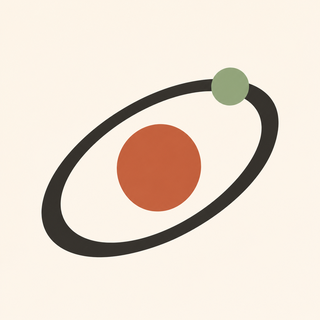
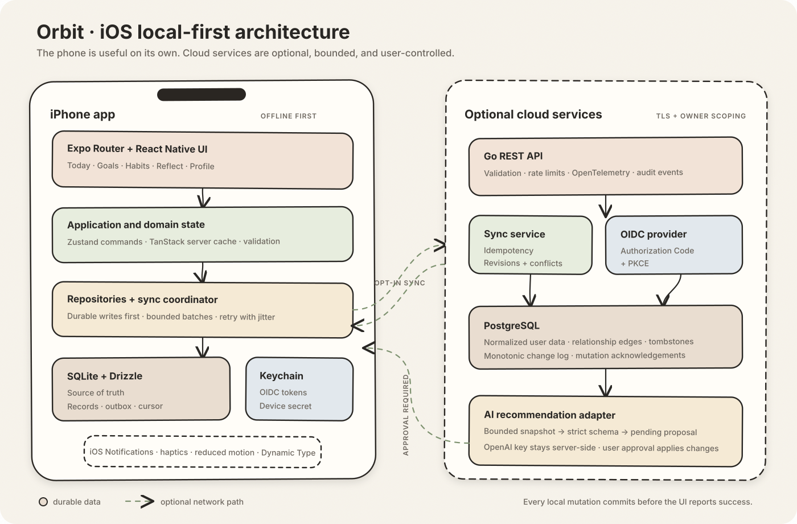

<p align="center">
  
</p>

<h1 align="center">Orbit</h1>

<p align="center"><strong>Stay aligned with the life you're building.</strong></p>

<p align="center">
  
  
  
  
</p>

<p align="center">
  A calm, private personal operating system for turning the life you want<br />
  into the choices you make today.
</p>

<p align="center">
  <a href="https://orbit.jonzhang.dev"><strong>Explore the interactive Orbit website →</strong></a>
</p>

---

Orbit is an iPhone-first personal operating system that connects long-term goals to the tasks, habits, milestones, and reflections that shape each day. The mobile application is local-first: creating a task, completing a habit, or writing a reflection commits to SQLite before the interface reports success. Cloud sync and AI are optional enhancements.

### Designed for the day, connected to the bigger picture

| Today | Life Graph | Adaptive planning |
| --- | --- | --- |
| A focused daily plan that works offline. | Every task and habit can explain which goal it advances. | Evidence-backed suggestions remain proposals until you approve them. |

## Status

Orbit is under active development. The repository currently targets Expo SDK 58, React Native 0.88, iOS 16.4+, Go, PostgreSQL, and an incremental revision-based sync protocol. The primary design and test device is an iPhone 15 Pro Max. Android is intentionally out of scope.

## Repository

```text
apps/mobile/                 Expo Router iOS application
services/api/                Go REST API and sync service
infrastructure/terraform/    Deployment configuration
docs/architecture/           System, sync, data, security, and AI design
docs/decisions/              Architecture decision records
docker-compose.yml           Local PostgreSQL + API stack
```

## How Orbit works

<p align="center">
  
</p>

See [architecture overview](docs/architecture/overview.md) and [synchronization protocol](docs/architecture/synchronization.md).

## Prerequisites

- Node.js 22.13 or newer
- pnpm 11
- Xcode 26.4 or newer for local iOS builds
- Docker Desktop for PostgreSQL and API containers
- Go 1.24 or newer when running the backend outside Docker

Windows can run linting, TypeScript tests, backend tests, and Expo web tooling, but an iOS simulator or signed device build requires macOS/Xcode or EAS Build.

## Local development

```bash
cp .env.example .env.local
pnpm install
docker compose up --build
pnpm ios
```

The mobile app remains useful without the API. Set `EXPO_PUBLIC_API_URL` only when testing sync. Store `OPENAI_API_KEY` in `.env.local` for the API service; it must never be added to `EXPO_PUBLIC_*` variables or bundled into the mobile app.

### Run on your iPhone from a Mac

1. Install Xcode, Node.js 22+, pnpm 11, and the Expo Go app on the iPhone.
2. Clone this repository and run `pnpm install` from its root.
3. Run `pnpm dev:mobile`, then scan the QR code with the iPhone Camera app while both devices are on the same network.
4. If local networking blocks the connection, run `pnpm --filter @orbit/mobile start --tunnel`.

Expo Go is the fastest daily loop. Before TestFlight or App Store submission, create a signed development build with EAS and verify notifications, Keychain, background behavior, accessibility, and release configuration on the physical phone.

### Run the optional API

The iPhone app does not need the API for local use. To exercise account-backed sync and server recommendations:

```bash
docker compose up --build
curl http://localhost:8080/health/ready
```

The Compose stack starts PostgreSQL, applies versioned migrations, and then starts the Go API. Development uses the explicit `ORBIT_DEV_USER_ID`; production refuses that bypass and requires a configured OIDC issuer and audience.

## Verification

```bash
pnpm lint
pnpm typecheck
pnpm test
pnpm api:test
docker compose config
```

Verified in the current Windows environment: TypeScript checking, ESLint, Jest domain tests, Go vet/tests, and an Expo production iOS bundle. Native compilation, Maestro, notifications, Keychain behavior, and physical-device accessibility still require the planned Mac/iPhone pass.

## Mobile builds

Development and App Store builds are defined in `apps/mobile/eas.json`.

```bash
pnpm --filter @orbit/mobile exec eas build --platform ios --profile development
pnpm --filter @orbit/mobile exec eas build --platform ios --profile production
```

Production submission still requires an Apple Developer account, final bundle identifier ownership, privacy disclosures, screenshots, app icon approval, and EAS project linkage. No deployment is claimed until a signed build and App Store Connect upload are verified.

## Privacy by design

- Guest mode requires no account.
- Core records live locally in SQLite.
- Cloud synchronization is opt-in.
- Reflection content is excluded from AI requests unless the user explicitly enables it for that request.
- AI output is a proposal; applying it always requires user approval.
- Access and refresh tokens belong in iOS Keychain through Expo SecureStore, never SQLite.

## Known limitations

- OIDC provider metadata and production hosting credentials are deployment-time configuration.
- Background sync timing is ultimately controlled by iOS.
- Local SQLite is not described as encrypted; highly sensitive tokens are stored separately in Keychain.
- The initial sync conflict policy merges independent fields and surfaces same-field conflicts; rich-text collaborative merging is not attempted.

## What is implemented

- Bilingual English / Simplified Chinese onboarding and application UI
- Offline task creation, completion, editing, rescheduling, and deletion
- Goals with deterministic milestone progress and an explorable Life Graph
- Habit creation and non-punitive daily completion
- Private daily reflections
- Local iOS planning reminders
- Durable mutation outbox, SecureStore device identity, incremental push/pull, and conflict capture
- OIDC-protected Go API, PostgreSQL schema, deterministic recommendations, and approval-gated AI proposals
- CI, Maestro journey, EAS profiles, Docker Compose, OpenAPI, and Google Cloud Terraform

## Road to TestFlight

1. Run the documented Mac + iPhone device pass and fix any native-only issues.
2. Choose and configure the production OIDC provider.
3. Link an EAS project and Apple Developer account.
4. Complete privacy nutrition labels, screenshots, and App Store metadata.
5. Produce a signed internal build, complete accessibility QA, then promote to TestFlight.

